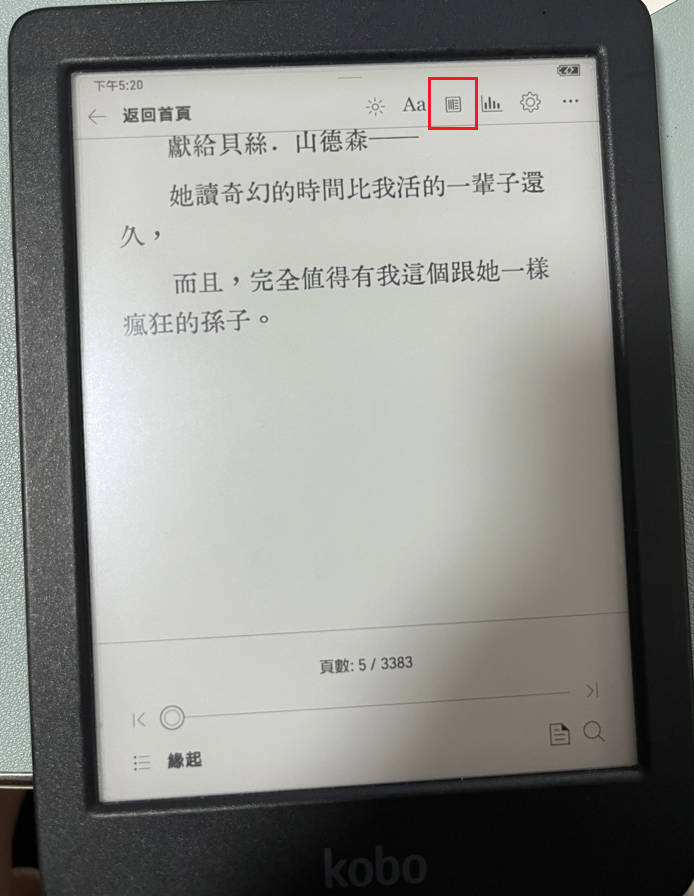

# NickelTurn

NickelTurn 是一項搭配 AI 寫成的**實驗性功能**，建議安裝前先備份閱讀器，並自行承擔使用風險。
本專案讓 Kobo 閱讀器使用者在閱讀時切換直排與橫排，目前僅支援 `KEPUB` 格式。安裝後，
閱讀工具列會出現 **直橫** 按鈕，可在閱讀時切換直排與橫排。

目前版本主要以 Clara BW 實機測試。先前曾在 Libra Colour 上測試，但後續版本未必有在該機種
重新驗證，因此無法保證相容。

本專案採用 [MIT License](LICENSE) 授權。


## 建置模式

舊的概念驗證階段已從公開建置介面移除。目前支援以下兩種建置模式：

| 模式 | 建置參數 | 用途 |
| --- | --- | --- |
| `full` | 預設值 | 提供 KEPUB 直橫排切換、JSON 快取、滑動翻頁方向調整，以及延遲還原原生書籤。 |
| `smoke` | `NT_BUILD=smoke` | 僅檢查外掛載入與 failsafe，不會變更書籍排版或狀態。 |

## 韌體相容性

目前使用單一通用 build，已在 4.45.23697 與 4.46.23852 韌體裝置上交叉測試。
這些匯出函式不是 Kobo 承諾跨韌體穩定的正式介面；未來韌體若改變必要符號或 ABI，再依實際失效情況調整。

在 Linux、macOS、WSL 或 Git Bash 的專案目錄執行以下指令，建置通用安裝包：

```sh
sh build.sh
```

可用 `sh build.sh --help` 查看建置說明；目前不需指定韌體版本。


## 使用方式

NickelTurn 不需要安裝 NickelMenu。開啟 KEPUB 後，點一下頁面叫出閱讀工具列，按下 **直橫** 即可切換
直排與橫排。

**直橫** 按鈕位於閱讀工具列中，和字體、亮度等控制項並排：



升級舊版時，NickelTurn 初始化會清除先前留下的 `.adds/nm/nickelturn` 設定、切換 script 和 ready marker。
清理只針對 NickelTurn 自己的舊檔，不會移除 NickelMenu 或其他 NickelMenu 設定，因此若已經不需要 Nickelmenu 請依照 Nickelmenu 官方網站說明卸載。

選擇的排版模式會儲存在：

```text
/mnt/onboard/.adds/nickel-turn/book-modes.json
```

JSON 使用 Kobo 原始的 `ContentID` 值作為索引，不會正規化 `file://` 前綴或路徑。

```json
{
  "books": {
    "file:///mnt/onboard/Books/example.kepub.epub": {
      "mode": "vertical-rl",
      "updatedAt": 1784590000
    }
  }
}
```

## 移除方式

在 `.adds/nickel-turn` 資料夾中新增名為 `uninstall` 的檔案，重新開機即會卸載相關檔案。

## Log 紀錄

所有診斷訊息都可以透過以下指令查看：

```sh
logread | grep NickelTurn | tail -n 120
```

重要的初始化與工具列操作事件也會寫入以下檔案：

```text
/mnt/onboard/.adds/nickel-turn/nickel-turn.log
```

## NickelHook 安全機制

- NickelHook 的 20 秒 failsafe 保持啟用。若啟動失敗，程式庫會被標記為 `.failsafe`，避免下次開機再次載入。
- 初始化讀取 JSON 時只開啟一次，解析到有容量上限的記憶體 POD 快取（檔案最多 1 MiB、最多 8192 筆）後立即關閉檔案。
- JSON 只會由 Qt timer 或工具列按鈕的 Qt signal handler 寫入，流程為 write → `fsync` → close → rename；
  不會讓使用者儲存區的檔案描述符持續開啟。
- CSS 與 reader hook 不會進行檔案 I/O；只在目前 KEPUB 的呼叫流程中執行有限工作，並使用快取的模式資料。
- 程式碼使用 Qt／C API，不使用 C++ 標準函式庫。

必要的 Nickel 函式符號會在初始化時檢查；缺少時初始化會回傳錯誤，讓 NickelHook 還原原始 hooks。
